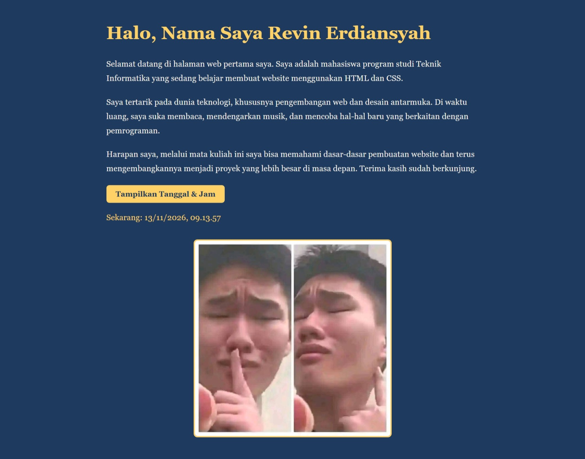

# Website Satu Halaman - Revin Erdiansyah

Tugas Pemrograman Web 1, Universitas Teknologi Bandung.

## Isi Website
- Judul halaman, 1 heading, dan 3 paragraf
- Elemen desain: warna background biru tua dan warna teks kuning
- Interaksi JavaScript: tombol yang menampilkan tanggal dan jam saat diklik

## Cara Menjalankan
Buka file `index.html` di browser.

## Screenshot Tampilan

